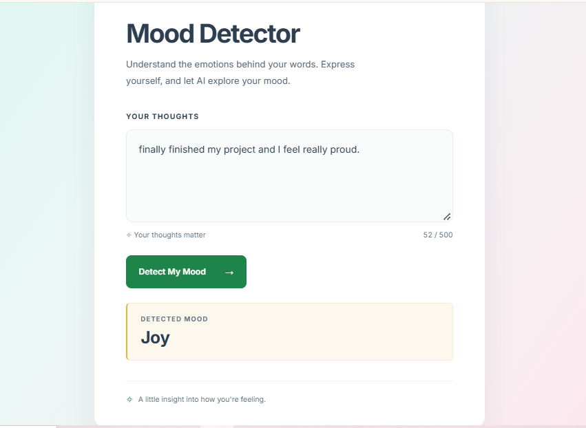
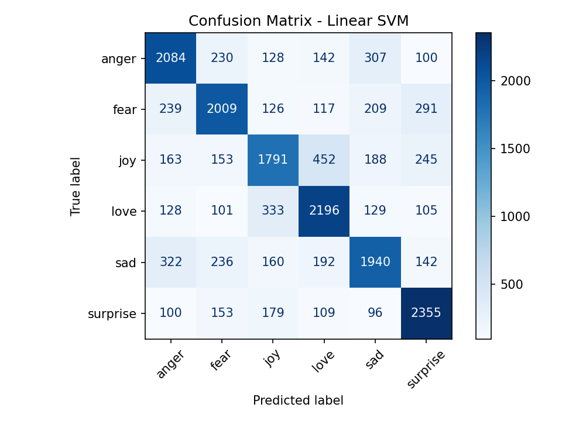
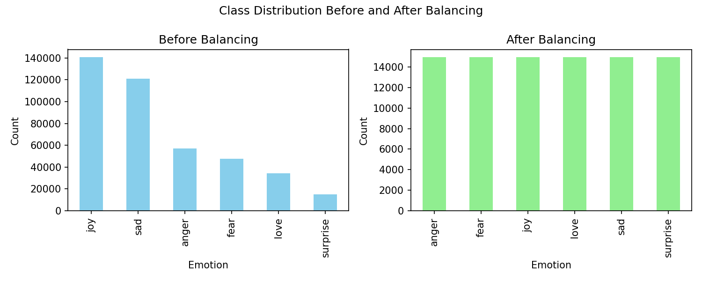

# Mood-Aware Emotion Classifier

A text emotion classifier with a web interface. Type a sentence and the model predicts one of six emotions: **anger, fear, joy, love, sadness, surprise**.

Built as an NLP course project (solo).



## Results

| Model                                | Accuracy  | Macro F1  |
| ------------------------------------ | --------- | --------- |
| Logistic Regression                  | 68.5%     | 0.684     |
| **Linear SVM (used in the app)**     | **68.9%** | **0.688** |
| Random guessing (6 balanced classes) | ~16.7%    | -         |

Evaluated on a held-out, stratified test set of 17,950 sentences (20% of the balanced data).



## How it works

1. **Data:** a labeled emotion dataset of about 416K sentences (`sentence`, `emotion`). Missing values, duplicates and the "empty" label were removed.
2. **Balancing:** undersampling to 14,959 sentences per emotion (89,754 in total), so no class dominates.
3. **Preprocessing (NLTK):** lowercasing, URL removal, tokenization, stop-word removal (keeping "not" for negation) and lemmatization.
4. **Features:** each sentence becomes a 384-dimensional vector with the pretrained Sentence-Transformer `all-MiniLM-L6-v2`.
5. **Models:** Logistic Regression and Linear SVM (scikit-learn), compared on the test set.
6. **Web app:** a Flask server with a JSON `/predict` endpoint and a JavaScript frontend.



## Tech stack

Python, scikit-learn, NLTK, Sentence-Transformers, pandas, NumPy, Matplotlib, Flask, JavaScript, HTML/CSS

## Project structure

```
├── main.py              # training and evaluation script
├── app.py               # Flask web app
├── templates/
│   └── index.html       # web page
├── static/
│   ├── script.js        # frontend logic
│   └── style.css        # styles
├── label_encoder.pkl    # saved label encoder
├── mood_model_best.pkl  # saved best model (Linear SVM)
├── screenshots/         # images used in this README
├── requirements.txt
└── README.md
```

## Run it

```bash
git clone https://github.com/Aleen-coder/mood-emotion-classifier.git
cd mood-emotion-classifier
pip install -r requirements.txt
python app.py
```

Open http://127.0.0.1:5000 and type a sentence.

The first run downloads the embedding model (about 90 MB) and some NLTK data, so it needs an internet connection.

### Retrain the model (optional)

1. Download an emotion dataset with the columns `sentence` and `emotion`, and save it as `combined_emotion.csv` in the project folder (the dataset is not included in this repo).
2. Run `python main.py`. It cleans and balances the data, trains both models, prints the evaluation, and saves the model files.
   - Encoding about 90K sentences takes roughly 10-15 minutes the first time. The embeddings are cached in `X_semantic_all.npy`.
   - To test quickly, set `SAMPLE_PER_CLASS = 1500` at the top of `main.py`.

## Limitations

- It always outputs one of six emotions, even for sentences with no clear emotion.
- It works on single sentences only, and does not handle sarcasm or mixed emotions.
- The accuracy was measured on a random split of the same dataset, so it may be lower on text from other sources.
- Some emotions overlap (for example joy and love), and dataset labels can be noisy.

## Future work

- Fine-tune a transformer model (for example DistilBERT) and compare it with this baseline.
- Show confidence scores for the top predictions.
- Analyze the most common errors.
- Test on text from other sources.

## Author

**Aleen Amer** - [GitHub](https://github.com/Aleen-coder) · [LinkedIn](https://linkedin.com/in/aleen-amer)

> Educational project. It does not provide medical or psychological advice.
